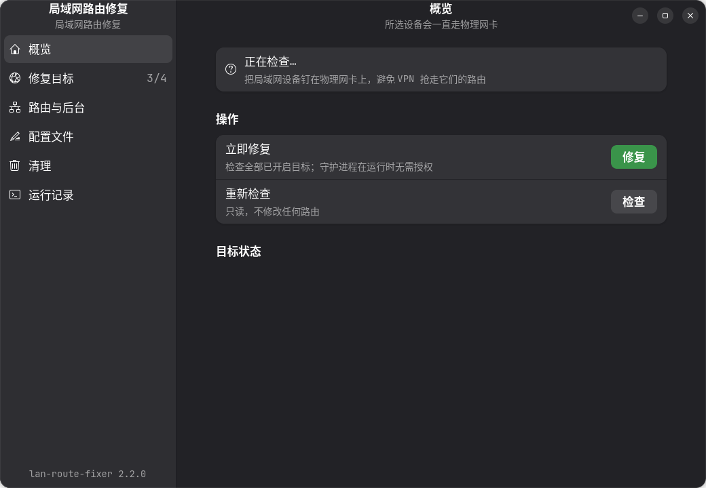
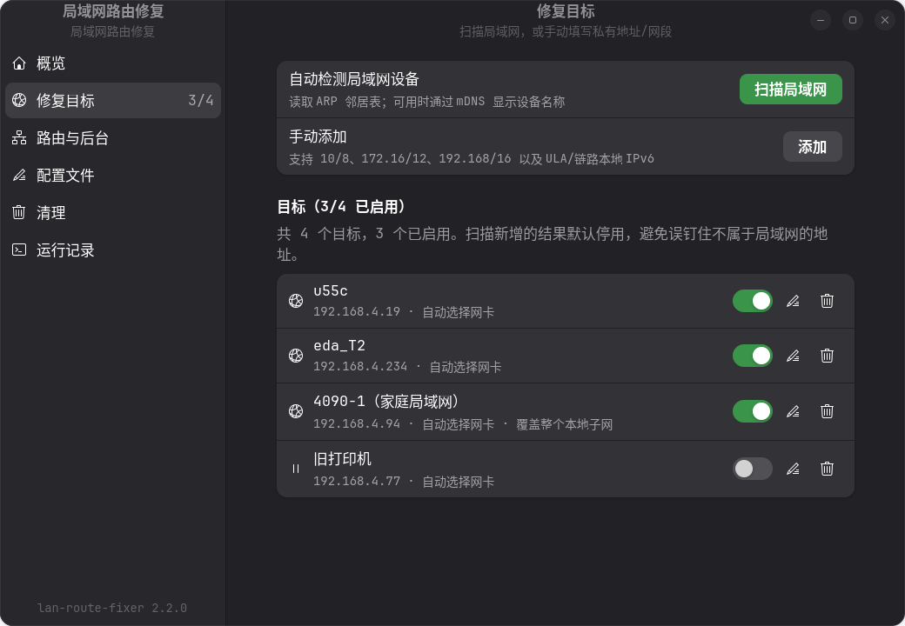
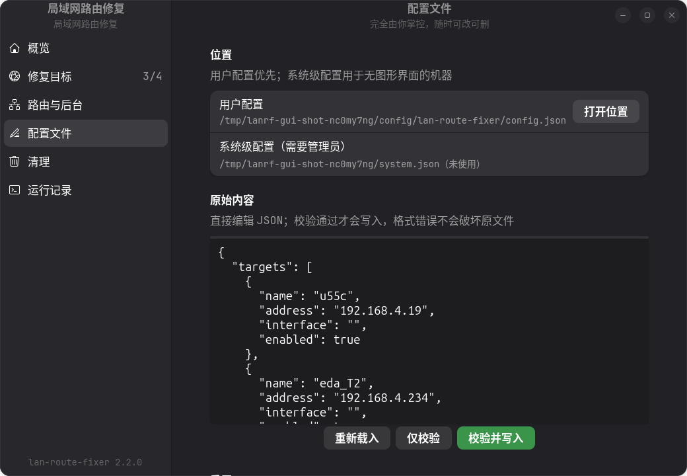
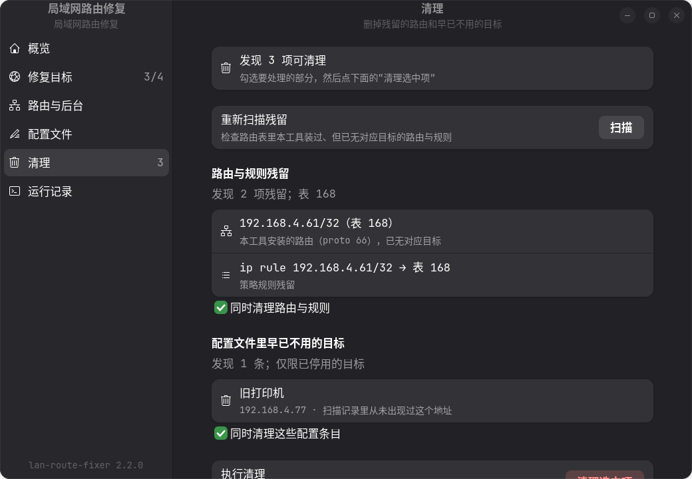
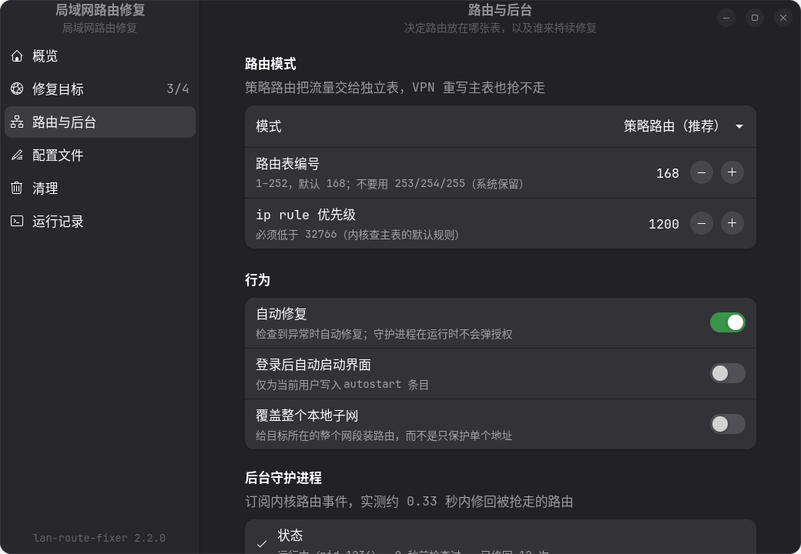

# lan-route-fixer

把选中的局域网设备「钉」在物理网卡上，避免 VPN 全隧道抢走私网路由后设备失联。

典型场景：

- aTrust / EasyConnect / 深信服等企业零信任客户端
- Deskflow / Synergy / Barrier / Input Leap 键鼠共享
- RDP / VNC / SSH / Sunshine 等远程桌面
- NAS / SMB / NFS 文件共享
- 打印机、IP 摄像头、IPMI/BMC、智能家居设备
- 内网 GitLab、数据库、开发服务器、树莓派

## 你是否遇到了这个问题？

```
先打开 aTrust，再连 SSH      -> 连不上（超时 / 无法路由到主机）
先连 SSH，再打开 aTrust      -> 可以，但新开的连接还是可能失败
```

这是 aTrust 这类客户端的典型行为：连接时它会枚举整个私网空间
（`10.0.0.0/8`、`172.16.0.0/12`、`192.168.0.0/16`），把每一个网段
**拆成 `/25`…`/32` 的碎片**，逐条塞进路由表指向它的 `utun7` 隧道设备。
在本机实测（aTrust 2.5.16）里，`192.168.4.0/24` 被拆成这样：

```
192.168.4.0/25     dev wlp0s20f3   # 恰好让给物理网卡
192.168.4.128/26   dev utun7       # 抢走
192.168.4.192/27   dev utun7       # 抢走
192.168.4.224/29   dev utun7       # 抢走
192.168.4.232/30   dev utun7       # 抢走
192.168.4.236/31   dev utun7       # 抢走
192.168.4.239/32   dev utun7       # 抢走
192.168.4.240/28   dev utun7       # 抢走
```

注意 `192.168.4.19`（`u55c`）恰好落在被让出的 `/25` 里，所以它「运气好」能用；
而 `192.168.4.94`、`192.168.4.234` 一旦被划进 `utun7` 的碎片，就会直接失联。
**更麻烦的是这套碎片划分不是固定的**：它会随 aTrust 的连接过程变化，
所以「昨天能用、今天不能用」是常态，而不是玄学。

2.0.x 版本的做法是「加一条更长前缀的路由」：

```sh
ip route replace 192.168.4.169/32 dev wlp0s20f3
```

方向是对的，但有两个致命弱点，也正是 2.1.0 要解决的问题。

### 弱点一：修得太慢（最长 30 秒空窗）

aTrust 在**连接瞬间**重写路由表。如果它把我们的 `/32` 删掉或覆盖，
2.0.x 只能等下一次 systemd timer 触发（默认 30 秒）才修好。
而 TCP 在几秒内就会重传失败，于是你看到的就是「SSH 断了 / 连不上」。

2.1.0 增加了 **rtnetlink 事件驱动守护进程**：直接订阅内核的
`RTM_NEWROUTE` / `RTM_DELROUTE` / `RTM_NEWLINK` 通知，路由一变就立刻重新对齐，
而不是等下一次轮询。

实测延迟（`tools/verify-namespace` 在真实内核上循环抢走路由并计时）：

| | 修复延迟 |
| --- | --- |
| 2.0.x（30 秒 timer） | 最长 **30 秒** |
| 2.1.0（事件驱动） | **约 0.33 秒**（3 次测量 0.33 / 0.34 / 0.34） |

这 0.33 秒不是内核通知的开销，而是刻意加的 **250ms 去抖**：aTrust 连接时会
一次灌进几百条路由，等这一批结束再统一处理，比处理 300 次更快也更安全。

### 弱点二：主表里的路由随时会被再抢一次

只在 `main` 表里放一条恰好正确的路由，是「碰巧对」，不是「锁定对」。
任何一次表重写都可能把它拿走。

2.1.0 默认启用**策略路由**：

```sh
ip rule add pref 1200 to 192.168.4.19/32 lookup 168   # 先看我们的表
ip route replace 192.168.4.19/32 dev wlp0s20f3 table 168 proto 66
```

`ip rule` 的优先级（1200）远高于内核查 `main` 表的默认规则（32766），
所以**只要规则在，aTrust 怎么改主表都影响不到这些目标**；
而 aTrust 不会去动别人加的 `ip rule`。

### 弱点三：反复弹授权框

2.0.x 的 GUI 是**自己**用 `pkexec` 改路由的。PolicyKit 的 `auth_admin_keep`
只缓存几分钟，所以只要 aTrust 反复把路由抢回去，你就会**无限次**被要求输密码。
更糟的是这会养成"看到密码框就输"的坏习惯。

2.1.0 把修复交给已经在 root 下运行的守护进程（D-Bus）：

```sh
# GUI 点"立即修复"时走的是这条：守护进程收到请求 → 重读配置 → 修复
# 全程没有密码框，因为没有任何权限被下放给调用方
busctl call io.github.pychen117.LanRouteFixer /Daemon \
    io.github.pychen117.LanRouteFixer.Control Repair
```

安全性并没有因此变松：**目标永远来自配置文件，不来自调用方**。
用户能通过 D-Bus 做的唯一一件事，就是让守护进程"现在再检查一遍"——
而他本来只要等下一个内核路由事件就能得到同样结果。
`pkexec` 仍然保留，用于"目标不在任何配置文件里"这种守护进程无法覆盖的情况。

## 2.2.0：一个窗口的界面 + 清理机制

2.1.0 解决的是"修得快不快"，2.2.0 解决的是"用久了界面越点越乱、残留越堆越多"。

### 侧栏单窗口，不再叠三层

之前的界面打开设置是**第二个窗口**，点编辑目标又是**第三个窗口**，
关的时候要一层层关回去，很容易迷路。2.2.0 改成
`Adw.NavigationSplitView`：左侧栏（概览 / 修复目标 / 路由与后台 / 配置文件 /
清理 / 运行记录），所有内容都在右半边，编辑目标作为 navigation page 滑入，
左上角返回。侧栏带徽标（几个目标异常、几项可清理），不用点进去就知道状态。





### 配置文件页：文件是你的

「配置文件」页显示配置文件的真实路径和**原始 JSON**，可以直接改、可以校验、
可以保存，也可以删除整个文件重新开始。保存前会先解析一遍 JSON，
语法错误会被拒绝而不是写坏文件；无法识别的键会原样保留（和 CLI 行为一致）。



### 清理页：别让残留的 IP 堆成屎山

两类垃圾会慢慢堆积：

1. **路由与规则残留**：目标删掉或停用后，之前装的 `proto 66` 路由和
   `ip rule` 不一定有人回收（守护进程运行时才会顺带回收；没开守护进程、
   配置被手工删掉、或换机器时就会留下）。
2. **配置里的僵尸条目**：`scan` 会把整个局域网的手机、打印机都扫出来，
   真正启用的往往只有两台，其余的作为「已停用」条目永远躺在配置里。

清理页把两者列出来，勾选后删除；命令行是同一套实现：

```sh
lan-route-fixer prune                     # 预演，只列不改
lan-route-fixer prune --yes               # 真正清理配置条目（不需要 root）
sudo lan-route-fixer prune --yes          # 连路由和规则一起删（需要 root）
lan-route-fixer prune --routes --days 7   # 只看路由残留，保留窗口临时改成 7 天
```



判定规则刻意保守：

- **只碰自己装的东西**：路由必须带 `proto 66`，规则必须指向本工具的表；
  Tailscale 的规则、VPN 的路由、DHCP 默认路由一律不动。
- **只清理已停用的目标**：开启中的目标无论离线多久都不会被建议删除——
  那是用户的决定，不是垃圾。
- **不碰别人的配置文件**：非 root 运行时只会读「系统配置 + 自己的配置」，
  也只改自己的（只有 root 能看到所有用户的配置，因为守护进程必须覆盖它们）；
  而路由归属始终按「所有已发现配置 + 显式 `--config`」计算，所以即使
  `--config` 指向一个很窄的文件，也不会把别的配置正在用的路由当成垃圾。
- **保留窗口可配**：`prune_after_days`（默认 30 天）。`scan` 会把每次看到的
  邻居写进 `~/.config/lan-route-fixer/discovered.json`，
  这样「上周刚停用」和「三月就消失的设备」可以区分开。
- **失败就说失败**：删不掉的条目会明确报错并让命令返回非 0，
  而不是假装清理成功。

## 安装

从源码构建 `.deb`：

```sh
cd lan-route-fixer
dpkg-buildpackage -us -uc -b
sudo apt install ../lan-route-fixer_2.2.0-1_all.deb
```

安装后：

- CLI：`lan-route-fixer scan|check|fix|list|status|doctor|prune|daemon|config ...`
- GUI：应用菜单打开「局域网路由修复」
- 后台：`lan-route-fixer-daemon.service`（事件驱动，实测约 0.33 秒修复）
  + `lan-route-fixer.timer`（60 秒兜底）+ NetworkManager dispatcher

## 快速开始（aTrust 场景）

```sh
# 1. 看看现在到底哪条路在抢流量
lan-route-fixer doctor

# 2. 把常用设备加进来（SSH 别名里的 IP 一定要加全）
lan-route-fixer add 192.168.4.19  --name u55c
lan-route-fixer add 192.168.4.234 --name eda_T2
lan-route-fixer add 192.168.4.94  --name 4090-1

# 3. 立刻修复（会弹一次授权）
lan-route-fixer fix

# 4. 确认后台守护进程在跑（这才是 0.33 秒级修复的关键）
systemctl status lan-route-fixer-daemon.service
lan-route-fixer status --daemon

# 5. 用久了想清理残留（先预演，确认后再加 --yes）
lan-route-fixer prune
```

> **易踩的坑**：本工具只保护**你配置过**的目标。
> 如果 `192.168.4.94` 没加进来，它现在可能「运气好」落在 aTrust 让出的
> `/25` 里，等 aTrust 换个碎片划分就会失联。
> 用 `lan-route-fixer check` 看一遍，或者直接把 SSH 配置里的局域网 IP 全加进来。
> 同时注意：**公司内网地址（例如 `10.10.60.101`）不要加**，
> 那些本来就应该走 VPN。

如果设备会频繁变动、或者懒得逐个维护，可以让某台设备连带保护整个子网
（只影响该网段，不会波及公司内网）：

```sh
lan-route-fixer add 192.168.4.19 --name "家里局域网" --expand
# 等价于给 192.168.4.0/24 装一条走物理网卡的路由，192.168.4.x 全部受保护
```

`--expand` 是**按目标**生效的，所以可以只对家庭网段开启、对其它目标保持单机保护。
全局开关是 `expand_host_targets`，默认关闭。

`doctor` 会直接点名「哪条更宽的路由把流量送去了 `utun7`」：

```
✗ u55c 状态异常：wrong-interface
    流量经由 utun7 而不是 wlp0s20f3
    → 更宽的路由 192.168.4.128/26 正在把流量送去 utun7；
      启用 routing_mode=rule 或保持守护进程运行可避免
```

## 命令参考

| 命令 | 说明 |
| --- | --- |
| `scan` | 扫描局域网邻居（ARP 邻居表 + mDNS 反解），输出 JSON，并记录"最后一次见到"的时间 |
| `check [--json]` | 检查所有已启用目标，退出码 0/1 便于脚本使用 |
| `fix [--quiet] [--direct]` | 修复；默认先请守护进程代劳（无授权），`--direct` 强制走 pkexec |
| `status [--json] [--daemon]` | 目标当前路由状态；`--daemon` 读守护进程状态文件 |
| `doctor [--json] [--no-probe] [--port N]` | 诊断：环境 / 路由 / 后台 / 连通性，并给出可执行建议 |
| `prune [--yes] [--routes] [--targets] [--days N] [--json]` | 清理残留路由/规则与早已不用的目标；默认只预演 |
| `daemon [--once] [--dry-run] [--interval N] [--dbus]` | 事件驱动修复循环；`--dbus` 额外提供控制接口 |
| `list / add / remove / enable / disable / set-interface` | 目标管理 |
| `config show\|get\|set\|paths` | 读写配置项 |
| `run [--once]` | 2.0.x 的前台循环（保留，等价于 `daemon`） |

常用配置项：

```sh
lan-route-fixer config set routing_mode rule        # rule（默认）| main
lan-route-fixer config set rule_table 168           # 1..252
lan-route-fixer config set rule_preference 1200
lan-route-fixer config set interval_seconds 10      # 守护进程的兜底轮询周期
lan-route-fixer config set expand_host_targets true # 把 /32 扩成所在子网
lan-route-fixer config set prune_after_days 30      # 停用多久没出现才建议清理
```

## 路由模型

```
                    ┌────────────────────────────────┐
 192.168.4.19 ────▶ │ ip rule pref 1200              │ 命中：查表 168
                    │   to 192.168.4.19/32 lookup 168│
                    └───────────────┬────────────────┘
                                    │
                    ┌───────────────▼────────────────┐
                    │ table 168                      │
                    │  192.168.4.19/32 dev wlp0s20f3 │ ← 我们装的，proto 66
                    └───────────────┬────────────────┘
                                    │ 未命中时继续
                    ┌───────────────▼────────────────┐
                    │ table main（aTrust 在这里刷表）│
                    └────────────────────────────────┘
```

- **策略路由**（`routing_mode=rule`，默认）：路由装在独立表 `168`，
  由一条 `ip rule` 引导；aTrust 重写 `main` 表无效。
- **主表兼容模式**（`routing_mode=main`）：只装 `ip route replace`，
  行为与 2.0.x 一致，适合极少数不兼容策略路由的环境。
- **proto 66 标记**：我们装的每条路由都带 `proto 66`，
  因此可以被准确识别、统计和回收，也不会误删别人的路由。
- **源地址固定**：路由带上 `src`，避免 VPN 存在时内核选错源地址。
- **规则垃圾回收**：目标被删除或停用后，对应的 `ip rule` 会自动清理
  （只清理指向我们自己表的规则，绝不动 Tailscale / 其他工具的规则）。



## 后台服务

| 单元 | 作用 | 延迟 |
| --- | --- | --- |
| `lan-route-fixer-daemon.service` | 订阅 rtnetlink，路由一变就修；同时提供 D-Bus 控制接口 | 实测 ~0.33s |
| `lan-route-fixer.timer` | 60 秒兜底轮询（守护进程没跑时的最低保障） | ≤60s |
| NetworkManager dispatcher | 网卡/VPN 状态变化时触发一次修复 | 秒级 |

三者可同时存在（修复是幂等的）。只想用其中一个：

```sh
sudo systemctl disable --now lan-route-fixer.timer
sudo systemctl enable  --now lan-route-fixer-daemon.service
```

守护进程会尊重每个配置文件的 `auto_fix`：为 `false` 时只检查、不修改。

### D-Bus 控制接口

通过 `lan-route-fixer-daemon.service`（`--dbus`）暴露在系统总线上：

| 成员 | 作用 |
| --- | --- |
| `Repair() -> s` | 立即重读配置并修复，返回 JSON 报告 |
| `GetStatus() -> s` | 返回守护进程最近一次状态（JSON） |
| `Reload()` | 触发一次重读（守护进程本来每次都会重读配置） |
| `StateChanged(s)` | 每次修复后广播状态 |
| `Version`（属性） | 接口版本，只读 |

服务名 `io.github.pychen117.LanRouteFixer`，对象路径 `/Daemon`，
接口 `io.github.pychen117.LanRouteFixer.Control`。
访问控制在 `/usr/share/dbus-1/system.d/`（只有 root 能注册名字），
方法调用另外还会校验调用方 UID 与守护进程一致。

```sh
busctl introspect io.github.pychen117.LanRouteFixer /Daemon
busctl call io.github.pychen117.LanRouteFixer /Daemon \
    io.github.pychen117.LanRouteFixer.Control GetStatus
```

## CLI 用法（更多示例）

```sh
# 扫描
lan-route-fixer scan --pretty

# 添加网段（网卡留空则自动按同网段匹配）
lan-route-fixer add 192.168.8.0/24 --name "NAS 网段" --interface eth0

# 修改 / 停用 / 删除
lan-route-fixer set-interface 192.168.4.19 auto
lan-route-fixer disable 192.168.4.19
lan-route-fixer enable  192.168.4.19
lan-route-fixer remove  u55c

# 系统级 / 无头配置
sudo mkdir -p /etc/lan-route-fixer
sudo lan-route-fixer --config /etc/lan-route-fixer/config.json add 192.168.4.19

# 前台调试（看它到底在做什么）
sudo lan-route-fixer daemon --interval 5
```

## 配置

- 用户配置：`~/.config/lan-route-fixer/config.json`
- 系统级配置：`/etc/lan-route-fixer/config.json`
- 守护进程状态：`/run/lan-route-fixer/state.json`（无权限时回退到用户配置目录）
- 邻居发现缓存：`~/.config/lan-route-fixer/discovered.json`（`scan` 写入，
  `prune` 读取；删掉它只会让"多久没出现"重新开始计时）

```json
{
  "targets": [
    { "name": "u55c", "address": "192.168.4.19", "interface": "", "enabled": true },
    { "name": "家里局域网", "address": "192.168.4.234", "interface": "", "enabled": true, "expand": true },
    { "name": "NAS 网段", "address": "192.168.8.0/24", "interface": "eth0", "enabled": true }
  ],
  "interval_seconds": 10,
  "auto_fix": true,
  "autostart": false,
  "routing_mode": "rule",
  "rule_table": 168,
  "rule_preference": 1200,
  "expand_host_targets": false,
  "prune_after_days": 30
}
```

2.0.x 的配置可以直接沿用：`ip` 作为 `address` 的别名仍然有效，
无法识别的键在保存时原样保留，新增键会自动补默认值。

`interface` 留空表示自动选择：先选与目标同网段的网卡，再选默认出口网卡。
`prune_after_days` 只影响 `prune` / 清理页的**建议**，不会自动删除任何东西。

## 安全边界

提权只发生在 `/usr/libexec/lan-route-fixer/lan-route-helper`（pkexec + polkit），
它只接受：

- 私有 IPv4（`10/8`、`172.16/12`、`192.168/16`、`169.254/16`）
  或 ULA / 链路本地 IPv6 目标；
- 已存在、非隧道、非回环的网卡（物理网卡，或 bridge/bond/vlan）；
- 路由表限定为 `1..252` 或 `main`；`local`/`default`/`253`/`254`/`255` 会被拒绝；
- 只会执行 `ip route replace` 和 `ip rule add/del`，没有 flush、没有 shell。

清理路由残留（`sudo lan-route-fixer prune --yes`）直接用 `ip route del` /
`ip rule del`，因此要 root；它只会删除"扫描时确认带 `proto 66`、
或指向本工具表"的条目，绝不会去动别人的路由。

守护进程可以额外用 systemd 沙箱限制（见单元文件里的
`CapabilityBoundingSet` / `ProtectSystem`）。

## 验证

```sh
# 单元测试（不需要 root，189 项）
python3 -m unittest discover -s tests -t .

# 真实内核端到端验证（不需要 root，在私有网络命名空间里跑，26 项检查）
bash tools/verify-namespace

# GTK 界面冒烟测试（不需要人点：建好每一页、切页、打开编辑器、渲染清理结果）
python3 tools/gui-smoke

# 把每一页渲染成 PNG（默认写进 docs/screenshots/）
python3 tools/gui-screenshot

# 在你自己的机器上验证（需要 root，会临时改路由，默认用空闲表 193 并自动还原）
sudo bash tools/verify-install
```

`tools/verify-namespace` 用 `unshare -Urn` 拿到一个私有网络命名空间，
在里面用**真实的 `ip` 和真实的内核路由代码**验证全部核心论断：

- `ip rule add` / `ip route replace ... table N proto 66` 的真实行为；
- 策略路由确实**抢在 main 表之前**（VPN 把整个 `/24` 抢走，目标仍走物理网卡）；
- VPN 再次重写 main 表后规则依然生效；
- daemon 修复被劫持的路由，并保留 `proto 66` 和固定源地址；
- **修复延迟实测**（3 次抢路由并计时，约 0.33 秒）；
- 停掉守护进程后没人再修复（证明延迟来自事件而不是轮询）；
- 删除目标后 `ip rule` 与路由被回收；
- `routing_mode=main` 兼容模式的行为；
- `prune` 在真实路由表里只回收带 `proto 66` 的孤儿路由/规则，
  同表里别人 `proto boot` 的路由和已配置目标的路由都不会被动。

`tools/gui-smoke` 在没有人类点击的情况下走完整棵控件树（40+ 项断言），
`tools/gui-screenshot` 顺手生成下面这些截图。

`--config` 选项、`fix --direct`、D-Bus 接口、`prune` 的预演/执行/失败路径
等则分别有单元测试覆盖。

## 项目结构

```
src/usr/bin/lan-route-fixer                    入口（CLI / GUI 分发）
src/usr/lib/lan-route-fixer/app.py             GTK4 / libadwaita 界面（侧栏单窗口）
src/usr/lib/lan-route-fixer/core.py            兼容层（保留 2.0.x 的 core.* 名字）
src/usr/lib/lan-route-fixer/lanrf/             可复用实现
    model.py        纯数据模型（目标、路由条目、proto 标记）
    targets.py      目标解析与校验
    config.py       配置读写 + 状态发布 + 发现缓存路径
    backends.py     平台后端协议与选择
    linux.py        Linux 后端（ip / sysfs / 路由与规则解析）
    windows.py      Windows 后端骨架（IP Helper API 映射）
    netlink.py      rtnetlink 事件订阅
    routing.py      网卡选择策略
    reconcile.py    纯协调引擎（检查 → 计划 → 执行 → 复核）
    checks.py       只读状态检查
    discovery.py    局域网邻居发现
    cleanup.py      垃圾回收（残留路由/规则 + 僵尸目标），CLI 与 GUI 共用
    privileged.py   提权边界客户端（pkexec）
    helper.py       提权边界内部（校验 + 改内核）
    system.py       多配置文件协调（systemd / dispatcher）
    daemon.py       事件驱动修复循环（select 模式 + GLib/D-Bus 模式）
    dbus.py         控制接口（服务端 + 客户端，失败即降级）
    doctor.py       诊断
    cli.py          命令行
src/usr/libexec/lan-route-fixer/                特权 helper 与 root 一次性修复
src/usr/share/dbus-1/system.d/                  D-Bus 访问控制（只有 root 能注册名字）
src/usr/share/dbus-1/system-services/           D-Bus 激活（GUI 调用时自动拉起守护进程）
docs/screenshots/                               README 使用的界面截图（tools/gui-screenshot 生成）
tools/verify-install                            真机验证（需要 root）
tools/verify-namespace                          真实内核验证（无需 root，26 项检查）
tools/gui-smoke                                 GTK 控件树冒烟测试（无需人点击）
tools/gui-screenshot                            把每一页渲染成 PNG
tools/plan-preview                              只读预览将要执行的 ip 命令
tests/                                          单元测试（含假后端）
```

## 移植到 Windows（设计说明）

代码从一开始就是按「同一套决策逻辑 + 可替换的平台后端」组织的，
所以移植是**填空**，不是重写：

- `lanrf/reconcile.py`、`routing.py`、`checks.py`、`targets.py`、`model.py`、
  `doctor.py` **零平台依赖**，一行都不用改。
- 平台差异全部收敛在 `lanrf/backends.py` 定义的 `NetworkBackend` 协议后面
  （查询：`link_kind` / `is_usable` / `local_networks` / `default_interfaces` /
  `route_lookup` / `routes` / `rules`；变更：`ensure_route` / `remove_route` /
  `ensure_rule` / `remove_rule`）。
- `lanrf/windows.py` 已经写好骨架与 API 映射表：

  | Linux | Windows（iphlpapi / netioapi） |
  | --- | --- |
  | `ip route show` | `GetIpForwardTable2` + `FreeMibTable` |
  | `ip route replace` | `CreateIpForwardEntry2` / `SetIpForwardEntry2` |
  | `ip route del` | `DeleteIpForwardEntry2` |
  | `ip route get` | `GetBestRoute2` |
  | `/sys/class/net`、`ip -d link` | `GetIpInterfaceTable` + `ConvertInterfaceLuidToNameW` |
  | `ip -o addr show` | `GetAdaptersAddresses` |
  | rtnetlink socket | `NotifyRouteChange2` |
  | `ip rule`（策略路由） | 无对应物，`supports_policy_rules = False` |
  | pkexec / polkit | Windows 服务（LocalSystem）或计划任务提权 |
  | D-Bus 系统总线 | 具名管道（`\\.\pipe\lan-route-fixer`）+ 服务 SID 上的 ACL |

  两个需要注意的行为差异已经记录在 `lanrf/windows.py` 的模块注释里：
  Windows 只有一张路由表（因此必须靠「更低 metric + 事件驱动即时修复」），
  以及 `CreateIpForwardEntry2` 在条目已存在时返回
  `ERROR_OBJECT_ALREADY_EXISTS`，需要回退到 `SetIpForwardEntry2`。

移植时需要新增的工作：实现 `WindowsBackend` 的十个方法、把
`lanrf/privileged.py` 的 pkexec 调用与 `lanrf/dbus.py` 的总线调用换成
具名管道（服务端跑在 LocalSystem，客户端把同样的 `Repair`/`GetStatus`
请求写进去即可，`reconcile` 层不需要改动）、提供 Windows 下的后台安装方式
（服务或计划任务）。其余（配置格式、CLI、诊断、协调策略）可以直接复用。

「反复弹授权」这个问题在 Windows 上同样存在（UAC），
所以"由常驻服务代劳、客户端只发请求"这个结构是刻意保留的：
它不依赖 PolicyKit，也不依赖 D-Bus 的具体实现。

## 开发

```sh
# 跑测试
python3 -m unittest discover -s tests -t .

# 不装到系统也能跑源码树
export LAN_ROUTE_FIXER_LIB=$PWD/src/usr/lib/lan-route-fixer
python3 src/usr/bin/lan-route-fixer doctor
```

便于测试的环境变量：`LAN_ROUTE_FIXER_LIB`、`LAN_ROUTE_FIXER_HELPER`、
`LAN_ROUTE_FIXER_PKEXEC`、`LAN_ROUTE_FIXER_IP`、`LAN_ROUTE_FIXER_STATE`、
`LAN_ROUTE_FIXER_SYSTEM_CONFIG`。
